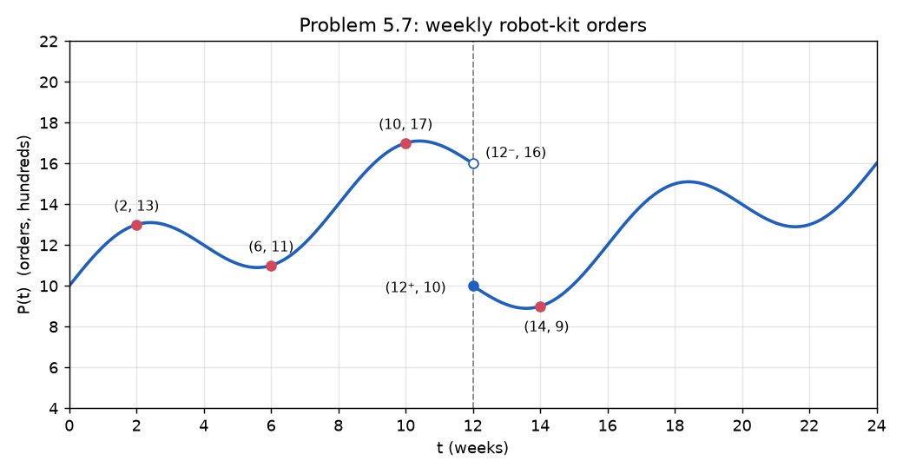

# Set 05: Math engine (optimisation, recurrences, graphs)

**Week 5** · 7 problems · target time 50 min · moves: M6, M7, M9, M13

> Check in `notebooks/05_math_optimization.ipynb`.

---

### 5.1 Where to put the charger? [3 pts]

Five robots sit on a line at positions `0, 1, 2, 10, 50`. One charger goes at position $x$.

**Output:** Find $x$ that minimises each of these:
(a) $\sum |x - x_i|$ (total distance)
(b) $\sum (x - x_i)^2$
(c) $\max |x - x_i|$ (worst-case distance)

Which answer barely moves if the robot at 50 moves to 500?

---

### 5.2 Does the budget bind? [3 pts]

You split GPU-hours between two models. Accuracy gains are $g_1 = 6h_1 - h_1^2$ and $g_2 = 8h_2 - h_2^2$, with $h_1 + h_2 \le B$ and $h_1, h_2 \ge 0$.

**Output:**
(a) With $B = 10$, find the maximum total gain.
(b) With $B = 5$, find the maximum total gain.
(c) A classmate set $h_1 + h_2 = 10$ and solved with "equal marginal gains" for (a). What did they get, and what went wrong?

---

### 5.3 AM-GM and Jensen [3 pts]

(a) A rectangular robot arena sits against a wall, so only 3 sides need fencing. You have 40 m of fence. Use AM-GM to find the maximum area.

(b) Three models predict 7, 10 and 16 for a true value of 10. Compute the **average squared error** of the three models, and the **squared error of their average prediction**. Which is smaller, and is that guaranteed? (Hint: Jensen.)

---

### 5.4 Growing user base [3 pts]

Each day 20% of active users leave, every active user brings in 0.3 new users, and 100 users sign up organically. So $U_{t+1} = 1.1\,U_t + 100$, with $U_0 = 1000$.

**Output:**
(a) Find $U_3$.
(b) Find the first day $t$ with $U_t > 5000$. (Hint: write $U_t + 1000$ as a geometric sequence.)

---

### 5.5 Kits from parts [3 pts]

Kit A uses 2 motors and 1 sensor, with profit ₹30. Kit B uses 1 motor and 3 sensors, with profit ₹40. You have 14 motors and 15 sensors.

**Output:**
(a) Find the corner point of the feasible region that maximises profit if fractional kits were allowed, and that profit.
(b) Find the best profit with **whole** kits.

---

### 5.6 Bases [2 pts]

(a) Write 2026 in base 7.
(b) In base $b$, "121" equals 144 in base 10. Find $b$. Why is "121" a perfect square in *every* base?

---

### 5.7 Read the model off the graph [3 pts]

Weekly orders follow
$$P(t) = A + Bt + E\sin\!\left(\frac{2\pi t}{T}\right) + D\cdot h(t-12),$$
where $h$ is the step function ($h(s) = 1$ if $s \ge 0$, else 0). The marked points lie exactly on the curve.

**Output:** Find $A, B, E, T, D$, then report $\lfloor P(25) \rfloor$.
